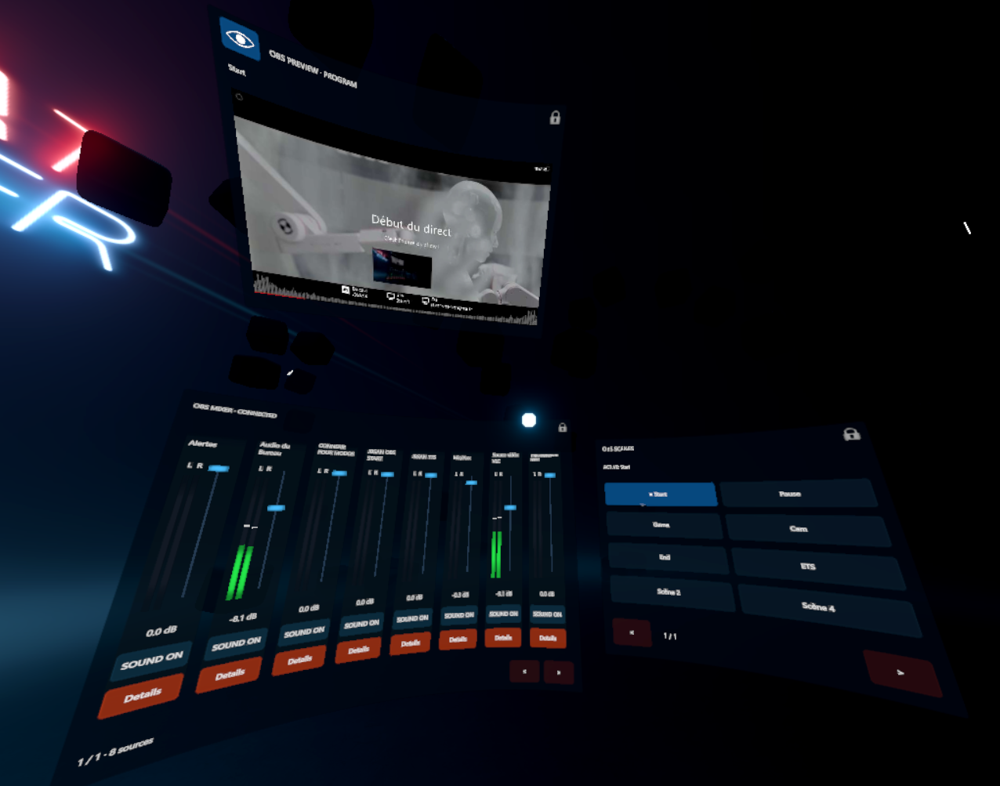
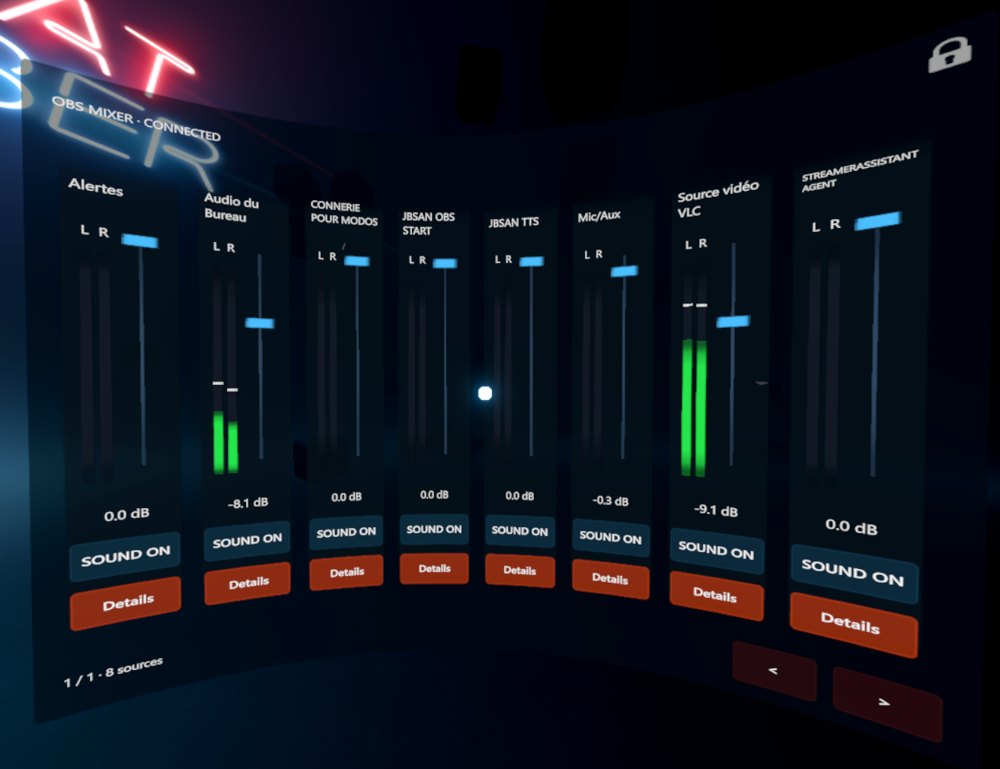
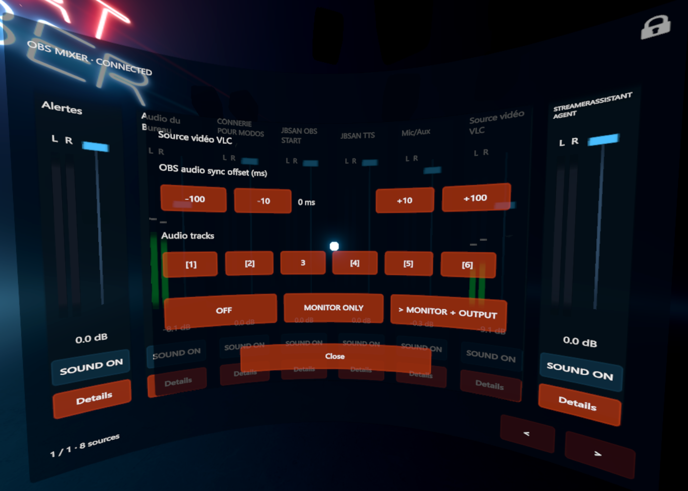
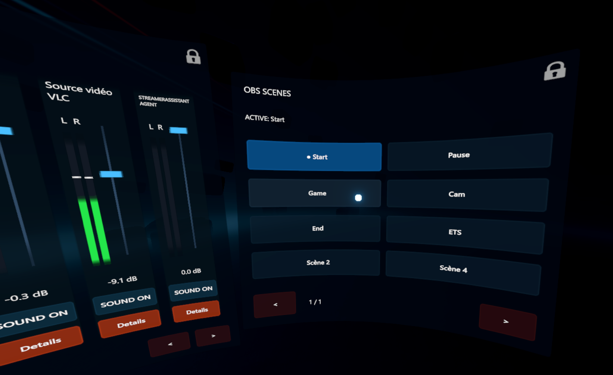
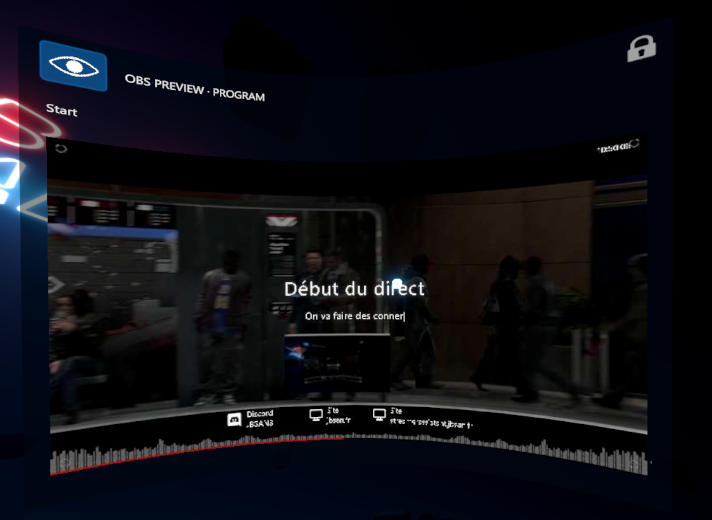
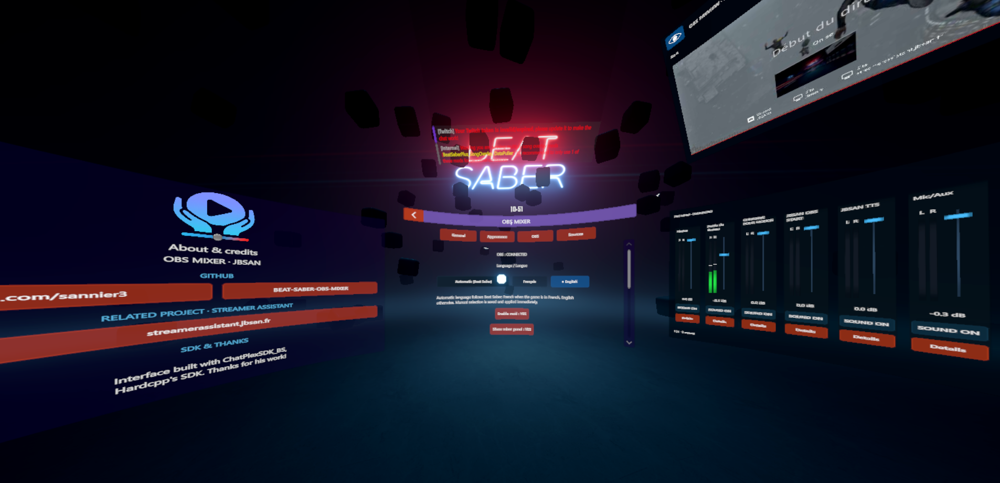

# OBS Mixer pour Beat Saber

Contrôlez votre mixage audio et vos scènes OBS sans retirer votre casque VR.

[English](README.md) | **Français**  
[Télécharger les releases](https://github.com/sannier3/BEAT-SABER-OBS-MIXER/releases) · [Signaler un problème](https://github.com/sannier3/BEAT-SABER-OBS-MIXER/issues)

OBS Mixer ajoute un mixeur audio flottant dans **Beat Saber PC 1.40.8**. Réglez le volume de vos sources, coupez leur son, surveillez les niveaux en direct et accédez aux pistes audio, au monitoring et au décalage audio. Une fenêtre de scènes optionnelle permet de changer de scène OBS et de voir celle qui est active. Une autre fenêtre optionnelle affiche un aperçu de la sortie Program OBS.

Les fenêtres apparaissent à l’accueil, dans la sélection des morceaux et pendant la pause. Elles restent masquées lorsque vous jouez.



*Le mixeur, les scènes et l’aperçu Program réunis dans Beat Saber.*

## Prérequis

| Élément | Version requise |
| --- | --- |
| Beat Saber | **PC Windows 1.40.8**, avec les mods activés |
| BSIPA | 4.3.x |
| ChatPlexSDK_BS | **6.4.2, 6.4.4 ou 6.4.5**, package pour Beat Saber 1.40.8 |
| BeatSaberMarkupLanguage (BSML) | 1.12.5 ou une version ultérieure compatible avec Beat Saber 1.40.8 |
| BS_Utils | 1.14.2 ou une version ultérieure compatible avec Beat Saber 1.40.8 |
| OBS Studio | Serveur obs-websocket **v5** activé, intégré à OBS Studio depuis la version 28 |

Deux ZIP sont disponibles : **OBSMixer-0.1.0.zip** inclut ChatPlexSDK_BS **6.4.2** ; **OBSMixer-0.1.0-without-sdk.zip** conserve votre SDK déjà installé. Avec BS+ ou un autre mod Hardcpp, utilisez le ZIP **sans SDK** si votre version est **6.4.2, 6.4.4 ou 6.4.5** et prévue pour Beat Saber **1.40.8**. N’écrasez pas un SDK plus récent avec celui du ZIP complet. Aucun module BS+ n’est nécessaire. Installez séparément BSIPA, BSML, BS_Utils et leurs dépendances. Les SDK 6.4.4 et 6.4.5 exigent aussi SongCore **3.15.0 ou supérieur compatible avec le jeu**.

Les API des versions 6.4.4 et 6.4.5 ont été vérifiées dans les DLL officielles ; leur fonctionnement en jeu reste à confirmer. La 6.4.1 manque d’une méthode utilisée par le mod ; la 6.4.3 et les versions ultérieures à 6.4.5 ne sont pas autorisées. Les autres versions du jeu et le Quest autonome ne sont pas pris en charge.

OBS Mixer se connecte directement à OBS. Aucun compte sur un site ni installation de Streamer Assistant n’est nécessaire.

## Installation

1. Fermez Beat Saber.
2. Ouvrez la [page Releases](https://github.com/sannier3/BEAT-SABER-OBS-MIXER/releases) et choisissez une version pour **Beat Saber 1.40.8**.
3. Téléchargez l’archive du mod jointe à la release, par exemple **OBSMixer-0.1.0.zip**. Les archives **Source code** proposées par GitHub sont destinées aux développeurs et ne s’installent pas directement.
4. Extrayez l’archive dans le dossier qui contient **Beat Saber.exe**. Fusionnez les dossiers `Plugins` et `Libs` avec ceux qui existent déjà.
5. Lancez le jeu, puis ouvrez **OBS Mixer** dans le menu des mods à gauche de l’accueil.

Les fichiers du mod doivent se trouver à ces emplacements :

```text
Plugins/OBSMixer.dll
Plugins/ChatPlexSDK_BS.dll
Libs/OBSMixer.Core.dll
```

Le ZIP sans SDK contient les deux DLL OBSMixer ; conservez votre `Plugins/ChatPlexSDK_BS.dll` compatible déjà présent.

Avec BSManager, ouvrez le dossier de votre **instance 1.40.8** et installez le mod dedans. Une release compilée s’installe sans PowerShell ni SDK .NET.

## Connexion à OBS

1. Lancez OBS Studio.
2. Ouvrez **Outils → Paramètres du serveur WebSocket** et activez le serveur.
3. Gardez l’authentification activée et copiez le mot de passe du serveur. Notez son port, généralement **4455**. Le [guide officiel OBS](https://obsproject.com/kb/remote-control-guide) détaille ces réglages.
4. Dans Beat Saber, ouvrez **OBS Mixer → OBS**.
5. Si OBS tourne sur le même PC, indiquez **127.0.0.1** comme hôte, le port OBS et le même mot de passe.
6. Appuyez sur **Connecter / appliquer**. Le statut doit passer à **CONNECTÉ**.

Vous pouvez activer la connexion au lancement et la reconnexion automatique dans ce même onglet. Après avoir corrigé un mot de passe refusé, appuyez de nouveau sur **Connecter / appliquer**.

## Utiliser le mixeur



Chaque tranche affiche le nom de la source, ses niveaux mono ou stéréo, un curseur de volume, sa valeur en dB, un bouton pour couper le son et **Détails**. Sur les tranches étroites, Détails apparaît sous la forme **…**.

- Déplacez un curseur pour modifier le volume de sa source dans OBS.
- Utilisez le bouton de son pour couper ou rétablir cette source.
- Ouvrez **Détails** pour modifier les pistes audio 1 à 6, le monitoring et le décalage audio OBS. Ce dernier ajuste la synchronisation du son de la source.
- Utilisez les flèches pour changer de page si nécessaire.

<details>
<summary>Voir le panneau Détails : pistes, monitoring et décalage audio</summary>



</details>

Ces commandes modifient directement OBS et sa sortie audio. Les noms des sources et des scènes sont ceux que vous avez définis dans OBS.

Par défaut, le mixeur affiche les sources audio contrôlables de la scène active et les périphériques audio globaux. Dans **Sources**, épinglez une source pour la conserver même hors scène, masquez celles qui ne vous intéressent pas ou changez leur ordre. Dans **Apparence**, **Sources à afficher** limite le total et **Sources par page** règle le nombre de tranches côte à côte.

## Fenêtre de scènes optionnelle

Activez **Général → Fenêtre des scènes OBS** pour afficher les boutons de scènes. Cette option est désactivée par défaut.

La scène active apparaît en bleu. Les boutons suivent l’ordre de la liste Scènes d’OBS, de gauche à droite puis à la ligne suivante, avec huit scènes par page. Les changements effectués dans OBS sont répercutés dans la fenêtre.



**Sélectionner une scène change la scène Program, y compris en mode studio. Si vous êtes en direct, cela change la scène envoyée à votre public.**

## Aperçu OBS optionnel



Activez **Général → Fenêtre d’aperçu OBS** pour afficher une image de la **sortie Program**, celle qui est envoyée à votre public. Il ne s’agit pas de la scène Preview séparée du mode studio. Cette fenêtre est désactivée par défaut. À sa première activation, son œil est fermé : ouvrez-le pour lancer l’actualisation de l’image.

- Utilisez le bouton en forme d’**œil en haut à gauche** pour afficher ou masquer l’image. La masquer arrête les demandes de capture, tout en conservant la fenêtre et ses commandes.
- Réglez **Intervalle aperçu (ms)** dans Général entre **100 et 10 000 ms**. La valeur par défaut est de **100 ms (0,1 seconde)**. Il s’agit d’une image actualisée périodiquement, pas d’un flux vidéo.
- Les captures fonctionnent uniquement lorsque l’image est affichée et qu’OBS est connecté. Une requête lente se termine avant d’en lancer une autre, sans accumulation.
- L’aperçu possède son propre cadenas et **une seule position enregistrée**, commune à l’accueil, à la sélection des morceaux et à la pause. Il reste masqué pendant une map.
- Son affichage est indépendant de celui du mixeur. Désactiver son option masque toute la fenêtre. Désactiver le mod masque toutes ses fenêtres.

## Position, apparence et langue

Les fenêtres sont verrouillées par défaut. Ouvrez le cadenas d’une fenêtre, déplacez-la et orientez-la avec votre contrôleur VR, puis relâchez-la pour enregistrer sa position. Refermez le cadenas pour la verrouiller.

Les fenêtres du mixeur et des scènes mémorisent chacune **trois positions distinctes** : accueil, sélection des morceaux et pause. Déplacez-la dans le contexte concerné pour régler cette position. Le panneau Détails suit le mixeur. L’aperçu utilise une seule position commune.

Les paramètres du mod regroupent :

| Onglet | Réglages |
| --- | --- |
| Général | Activation du mod, affichage du mixeur, fenêtres de scènes et d’aperçu, intervalle de capture, langue et filtrage des sources |
| Apparence | Largeur, hauteur, échelle, texte, opacité, courbure et nombre de sources |
| OBS | Adresse, port, mot de passe, connexion et reconnexion |
| Sources | Épinglage, masquage et ordre des sources audio |

La langue est réglée sur **Automatique (Beat Saber)** par défaut : français si le jeu est en français, anglais dans les autres cas. Vous pouvez choisir **Français** ou **English** à tout moment. Le choix est enregistré et s’applique sans redémarrer.

<details>
<summary>Voir les paramètres et le panneau À propos</summary>



</details>

**F8** affiche ou masque le mixeur. **F9** réinitialise sa position dans le contexte courant et l’affiche. Ces raccourcis ne font pas apparaître le mixeur pendant une map.

## Apparence par défaut

Le mixeur démarre avec **8 sources par page**, sans limite totale de sources, une fenêtre de **180 × 130**, une échelle de **0,75**, un texte de taille **3,0**, une opacité du fond de **85 %** et un rayon de courbure de **200**. Toutes les fenêtres sont verrouillées. Les fenêtres de scènes et d’aperçu sont désactivées, avec l’image d’aperçu masquée et un intervalle de **100 ms**.

Ces valeurs s’appliquent aux nouvelles installations et aux réglages qui n’ont pas encore été enregistrés. Une mise à jour conserve votre configuration existante et vos positions.

## Mise à jour et désinstallation

Pour mettre à jour le mod, fermez le jeu puis remplacez les deux DLL par celles de la nouvelle release adaptée à votre version de Beat Saber. Conservez **UserData/OBSMixer.json** pour garder la connexion OBS, la langue et les positions.

Pour désactiver temporairement le mod, utilisez l’option correspondante dans **Général**. Les paramètres restent accessibles depuis l’accueil. Pour le désinstaller, fermez le jeu puis supprimez `Plugins/OBSMixer.dll` et `Libs/OBSMixer.Core.dll`.

## Dépannage

| Problème | Vérification |
| --- | --- |
| OBS Mixer n’apparaît pas dans le menu des mods | Vérifiez la version du jeu, les dépendances et l’emplacement des DLL, puis relancez le jeu. |
| Le mixeur est invisible | Activez le mod et le panneau dans Général. Cherchez-le à l’accueil, dans la sélection des morceaux ou en pause. F9 restaure sa position dans ce contexte. |
| OBS ne se connecte pas | Gardez OBS ouvert, activez son serveur WebSocket et vérifiez l’hôte, le port et le mot de passe. Cliquez sur Connecter / appliquer après modification. |
| Une source manque | Vérifiez sa présence dans la scène active, son masquage et la limite de sources. Épinglez-la dans Sources si nécessaire. |
| Les boutons de scènes sont absents | Activez la fenêtre optionnelle dans Général et vérifiez la connexion à OBS. |
| L’aperçu est absent ou vide | Activez sa fenêtre dans Général, ouvrez l’œil et vérifiez la connexion OBS. Il reste masqué pendant une map. |
| La langue ne convient pas | Choisissez Français ou English dans Général, ou vérifiez la langue de Beat Saber si le mode Automatique est sélectionné. |

Pour obtenir de l’aide, [ouvrez une issue](https://github.com/sannier3/BEAT-SABER-OBS-MIXER/issues) avec les versions du jeu et du mod, les étapes pour reproduire le problème et le journal Beat Saber concerné. **Ne partagez pas votre mot de passe OBS ni le fichier de configuration qui le contient.**

## Crédits et liens

Un projet de **JBSAN**, réalisé avec **ChatPlexSDK_BS de Hardcpp** pour l’interface VR. Le logo Streamer Assistant apparaît centré en haut du panneau À propos dans le jeu.

- [Code source du projet et releases](https://github.com/sannier3/BEAT-SABER-OBS-MIXER)
- [Profil GitHub : sannier3](https://github.com/sannier3)
- [Projet associé : Streamer Assistant](https://streamerassistant.jbsan.fr)
- [ChatPlexSDK_BS de Hardcpp](https://github.com/hardcpp/ChatPlexSDK_BS)
- [BeatSaberMarkupLanguage](https://github.com/monkeymanboy/BeatSaberMarkupLanguage), [BS_Utils](https://github.com/Kylemc1413/Beat-Saber-Utils) et [obs-websocket](https://github.com/obsproject/obs-websocket)

Pour compiler le projet, consultez [DEVELOPMENT.fr.md](DEVELOPMENT.fr.md). Les notes de compatibilité et de validation sont dans [COMPATIBILITY.fr.md](COMPATIBILITY.fr.md) et [VALIDATION.fr.md](VALIDATION.fr.md).

Le package contient les mentions de copyright du SDK et les licences des composants tiers. Consultez les [mentions tierces](THIRD-PARTY-NOTICES.fr.md).

## Documentation

[Guide utilisateur](README.fr.md) · [Développement](DEVELOPMENT.fr.md) · [Compatibilité](COMPATIBILITY.fr.md) · [Validation](VALIDATION.fr.md)
